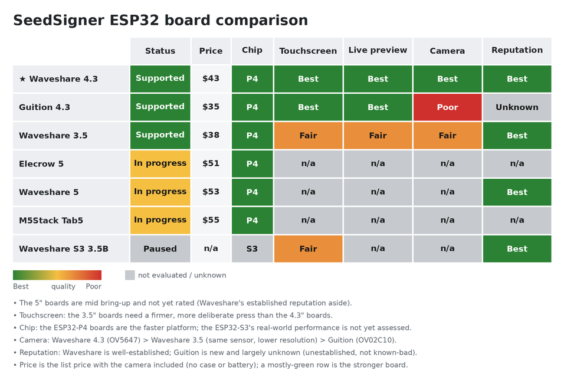

# Board hardware details

Full detail on the boards this firmware targets. For the at-a-glance list (price, status), see the
**Supported hardware** table in the [README](../README.md). Prices are list prices for the version
that includes the camera, checked October 2026 (the Guition's in July 2026).

## At a glance

A mostly-green row is the stronger board. Regenerate after editing the ratings with
`python3 tools/gen_board_comparison.py`.

## Boards

### Waveshare ESP32-P4-WIFI6-Touch-LCD-4.3: ✅ Supported · ⭐ Recommended

**The recommended board**: the most thoroughly tested and the main focus of development. ESP32-P4
with a 4.3″ 480×800 **MIPI-DSI** panel (ST7701) and an OV5647 camera. The OV5647 is **included** at
the listed ~$43 (it is an optional add-on otherwise).
[Product page](https://www.waveshare.com/esp32-p4-wifi6-touch-lcd-4.3.htm)

### Guition JC4880P443: ✅ Supported

A low-cost, non-Waveshare twin of the P4-4.3: ESP32-P4 with a 4.3″ 480×800 **MIPI-DSI** panel
(ST7701S), GT911 touch, an **OV02C10 camera onboard**, 32 MB PSRAM, and 16 MB flash. The ~$35
listing is the bare board; an [enclosed version](https://www.aliexpress.us/item/3256809487310720.html)
is ~$41.
[Product page](https://www.aliexpress.us/item/3256809431944589.html)

### Waveshare ESP32-P4-WIFI6-Touch-LCD-3.5: ✅ Supported

ESP32-P4 with a 3.5″ 320×480 **SPI** panel (ST7796) and an onboard camera. The listed ~$38 is the
no-battery configuration.
[Product page](https://www.waveshare.com/esp32-p4-wifi6-touch-lcd-3.5.htm)

### Elecrow CrowPanel Advance 5″ ESP32-P4: 🛠️ Bring-up in progress

ESP32-P4 with a 5″ 800×480 **parallel RGB** panel, GT911 touch, 32 MB PSRAM, and 16 MB flash. It is
the only board here with a landscape-native panel, so the UI needs no per-frame rotation (see
[Display performance](#display-performance-mipi-dsi-vs-spi)). The listed ~$51 is the **"With 2MP
Camera"** version (SC2336, MIPI-CSI); the cheaper "Without Camera" version ships no camera, so order
the camera version. Display, touch, and SD card work; the camera streams, but its color and exposure
are not tuned yet.
[Product page](https://www.elecrow.com/crowpanel-advanced-5inch-esp32-p4-hmi-ai-display-800x480-ips-touch-screen-with-wifi-6.html)

### Waveshare ESP32-P4-WIFI6-Touch-LCD-5: 🛠️ Bring-up in progress

ESP32-P4 with a 5″ 720×1280 **MIPI-DSI** panel (HX8394) and an OV5647 camera (**included** at the
listed ~$53). Two defects are still open: the UI refreshes at only about 5 fps, because every frame
is CPU-rotated 90° from the portrait-native panel (see
[Display performance](#display-performance-mipi-dsi-vs-spi)), and the camera does not reopen after
its first use.
[Product page](https://www.waveshare.com/esp32-p4-wifi6-touch-lcd-5.htm)

### M5Stack Tab5: 🛠️ Bring-up in progress

ESP32-P4 with a 5″ 1280×720 **MIPI-DSI** panel, a 2 MP SC2356 camera, 32 MB PSRAM, and 16 MB flash.
The camera faces the front (toward the user), so QR scanning needs it rerouted to face out the back.
It unplugs from a 24-pin FPC connector, and the stock flex is likely long enough to reach a rear
mount, though that is not confirmed yet (§3b of the
[hardware evaluation](esp32-p4-hardware-evaluation.md)). M5Stack has changed the display and touch
controllers between production runs (ILI9881C with GT911 touch on early units, an integrated ST7123
or ST7121 since), so check the sticker on the back of the unit. The listed ~$55 excludes the
optional NP-F550 battery ($60 with it).
[Product page](https://shop.m5stack.com/products/m5stack-tab5-iot-development-kit-esp32-p4)

### Waveshare ESP32-S3-Touch-LCD-3.5B: ⏸️ Paused

ESP32-S3 with a 3.5″ 320×480 display. Work on it is paused; if it resumes, it would be a
lower-performance target than the P4 boards (see below).
[Product page](https://www.waveshare.com/esp32-s3-touch-lcd-3.5b.htm)

## Display performance: MIPI-DSI vs SPI

The 3.5″ board's display is noticeably slower than the 4.3″ boards (the Guition is a MIPI-DSI 4.3″
board like the Waveshare).

- *In practice:* the **live camera preview (QR scanning) is noticeably choppier** on the 3.5″. Static
  screens and menus are largely unaffected.
- *Why:* the 4.3″ boards drive their panels over **MIPI-DSI**, while the 3.5″ uses a slower **SPI**
  bus that can't push full-frame camera updates as fast.

Panel orientation matters too. The DSI panels are portrait-native while the UI is landscape, so
every refresh CPU-rotates the full frame 90°. That costs about 19 ms per refresh on the 480×800
boards but about 85 ms on the Waveshare 5″'s 720×1280 panel, a cost that grows faster than the
pixel count. The Elecrow's landscape-native RGB panel skips the rotation entirely.

## ESP32-P4 vs. ESP32-S3

The P4 is the faster board where it counts.

- *In practice:* the live camera preview is smoother, QR and animated-QR codes scan and decode
  noticeably quicker, and signing operations (cryptographic math, PSBT parsing) feel snappier than on
  the S3.
- *Why:* the P4 has a faster CPU (**400 MHz dual-core RISC-V** vs. the S3's **240 MHz dual-core
  Xtensa**) plus camera and display hardware the S3 lacks: a hardware **image signal processor** and
  **MIPI** interfaces, where the S3 falls back to slower parallel/QSPI buses.

That gap is why S3 support is uncertain. If it does land, the S3 stays the lower-performance option,
not a peer of the P4.
